<picture><source media="(prefers-color-scheme: dark)" srcset="assets/hero-dark.svg"></picture>

<a href="https://www.danielrajakumar.com"><picture><source media="(prefers-color-scheme: dark)" srcset="assets/link-website-dark.svg"></picture></a>
<a href="https://rockygpt.danielrajakumar.com"><picture><source media="(prefers-color-scheme: dark)" srcset="assets/link-rockygpt-dark.svg"></picture></a>
<a href="https://linkedin.com/in/daniel-rajakumar"><picture><source media="(prefers-color-scheme: dark)" srcset="assets/link-linkedin-dark.svg"></picture></a>
<a href="mailto:contact@danielrajakumar.com"><picture><source media="(prefers-color-scheme: dark)" srcset="assets/link-email-dark.svg"></picture></a>

<picture><source media="(prefers-color-scheme: dark)" srcset="assets/about-dark.svg"></picture>

## What I've built

<a href="https://rockygpt.danielrajakumar.com"><picture><source media="(prefers-color-scheme: dark)" srcset="assets/card-rockygpt-dark.svg"></picture></a>
<a href="https://github.com/daniel-rajakumar/Bubble-PoppAR"><picture><source media="(prefers-color-scheme: dark)" srcset="assets/card-bubble-poppar-dark.svg"></picture></a>
<a href="https://github.com/daniel-rajakumar/VC370"><picture><source media="(prefers-color-scheme: dark)" srcset="assets/card-vc370-dark.svg"></picture></a>
<a href="https://github.com/daniel-rajakumar/CanogaGame"><picture><source media="(prefers-color-scheme: dark)" srcset="assets/card-canoga-dark.svg"></picture></a>

## Tools I use

<picture><source media="(prefers-color-scheme: dark)" srcset="assets/tools-dark.svg"></picture>

## My year in code

<picture><source media="(prefers-color-scheme: dark)" srcset="generated/snake-dark.svg"></picture>

## Outside of code

<picture><source media="(prefers-color-scheme: dark)" srcset="assets/outside-dark.svg"></picture>

