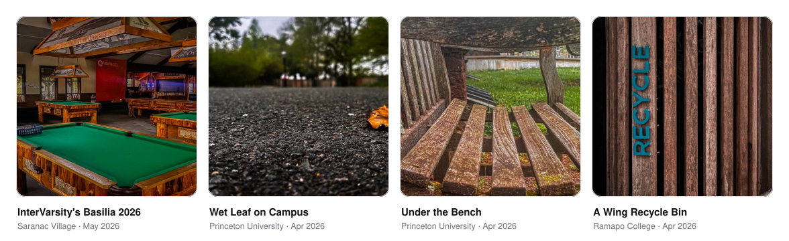

<picture>
  <source media="(prefers-color-scheme: dark)" srcset="assets/hero-dark.svg">
  
</picture>

  
  
  
  

I build full-stack web apps in TypeScript and Next.js, lately with a focus on retrieval systems and the tests that keep them honest.

- 🎓 B.S. in Computer Science, Ramapo College of New Jersey (2026)
- 💼 Software engineering intern at **dsm-firmenich**, where I built and launched an internal assessment platform as the sole developer
- 🤖 Building **[RockyGPT](https://rockygpt.danielrajakumar.com)**, a campus assistant for Ramapo that answers with linked sources

## What I've built

<a href="https://rockygpt.danielrajakumar.com"><picture><source media="(prefers-color-scheme: dark)" srcset="assets/card-rockygpt-dark.svg"></picture></a>
<a href="https://github.com/daniel-rajakumar/Bubble-PoppAR"><picture><source media="(prefers-color-scheme: dark)" srcset="assets/card-bubble-poppar-dark.svg"></picture></a>
 
<a href="https://github.com/daniel-rajakumar/CanogaGame"><picture><source media="(prefers-color-scheme: dark)" srcset="assets/card-canoga-dark.svg"></picture></a>
<a href="https://github.com/daniel-rajakumar/VC370"><picture><source media="(prefers-color-scheme: dark)" srcset="assets/card-vc370-dark.svg"></picture></a>
 
<a href="https://github.com/daniel-rajakumar/imageSplitter"><picture><source media="(prefers-color-scheme: dark)" srcset="assets/card-image-splitter-dark.svg"></picture></a>
<a href="https://github.com/daniel-rajakumar/photography-website"><picture><source media="(prefers-color-scheme: dark)" srcset="assets/card-photography-dark.svg"></picture></a>

Try them live: <a href="https://rockygpt.danielrajakumar.com">RockyGPT</a> · <a href="https://projects.canogagame.danielrajakumar.com">Canoga Game</a> · <a href="https://image-splitter-eight.vercel.app">Image Splitter</a> · <a href="https://photography-website-ebon.vercel.app">Photography</a>

## Tools I use

  

## My year in code

<picture>
  <source media="(prefers-color-scheme: dark)" srcset="generated/snake-dark.svg">
  
</picture>

## Through my lens

<a href="https://photography-website-ebon.vercel.app"><picture><source media="(prefers-color-scheme: dark)" srcset="assets/photos-dark.svg"></picture></a>

## Outside of code

- Led Ramapo's Google Developer Student Club and organized the college's first DevFest
- Founded Ramapo's Computer Science Club
